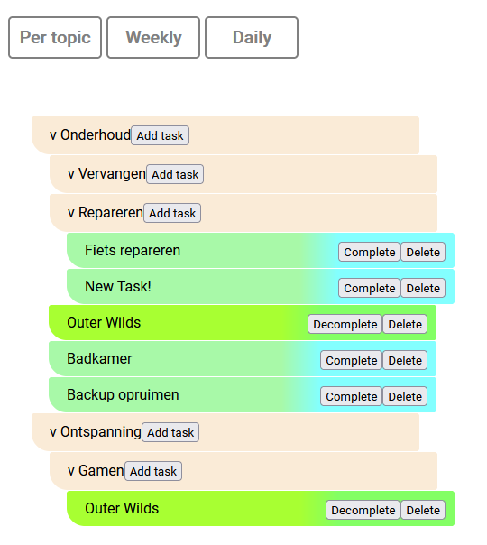

# TaskPlanner

> This React App allows you to plan tasks in a by-topic view, a weekly view and a daily view simultaneously.




## Usage

Download the code or fork the repository and git clone it to your computer.

Install dependencies with Bun 1.4.5:

```sh
bun install
```

Start the Vite development server on port 3000:

```sh
bun run start
```

Open `http://localhost:3000`.


Build for GitHub Pages:

```sh
bun run build
```

The output is written to `build`, with the base path `/TaskPlanner_javareact/`.
To preview the production build locally:

```sh
bun run preview
```

Open `http://localhost:3001/TaskPlanner_javareact/`.

## Features

- A per-topic view of all tasks. Tasks can be in multiple topic. Tasks can have subtasks. Topics can have subtopics.
- A planned view, where you can collect all tasks to be done this week. Can support tasks that are not visible in the per-topic view.
- A schedule view, where you can schedule all planned tasks on a calendar. Can also support tasks not visible in the planned and per-topic view.
- A list of all tasks, where you can easily look for groups of (sub)tasks that have certain attributes. Also pretty easy for tagging all tasks.

## Future plans

The todo-list is self-hosted in the problem. In the future it will output a markdown file, that will be automatically shown in the GitHub pages. For now, it is:
- [x] Make tasks draggeable/moveable
- [x] Add loading/saving interaction
- [x] Add weekly view
- [ ] Add daily view
- [ ] Animate collapse and dropdown

## Checks

Jest remains available through `bun run test --watchAll=false --runInBand`.
Vite builds do not run ESLint or TypeScript checking automatically.
Run linting and the existing scoped TypeScript checks separately:

```sh
bun run lint
bun run typecheck
bun run typecheck:strict
```

Linting uses standalone ESLint with JavaScript, JSX, TypeScript, TSX, and React Hooks/Compiler diagnostics. Existing diagnostics are reported without automatic fixes. Neither linting nor type checking is part of the production build or deployment workflow.

To reproduce the locked installation:

```sh
bun install --frozen-lockfile
```

## Deployment

The GitHub Pages workflow uses Bun and uploads `build` on pushes to the `deploy` branch or a manual workflow run.
The existing `bun run deploy` command also publishes `build` using gh-pages.
